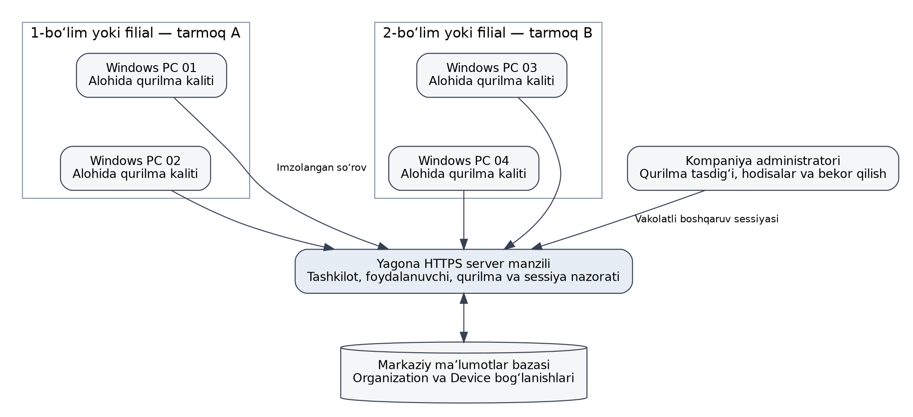
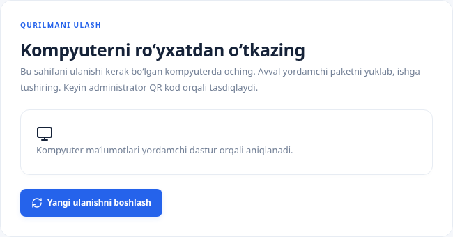
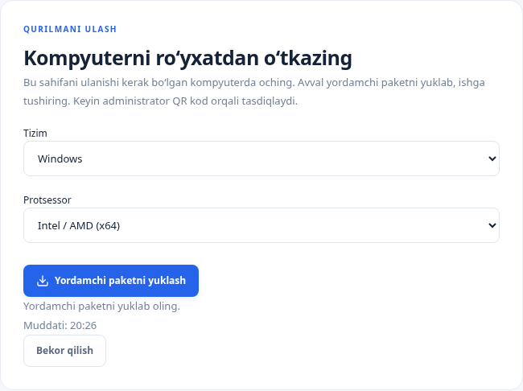
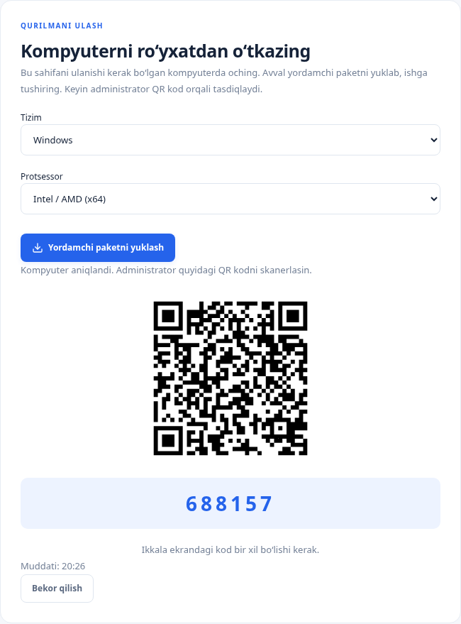
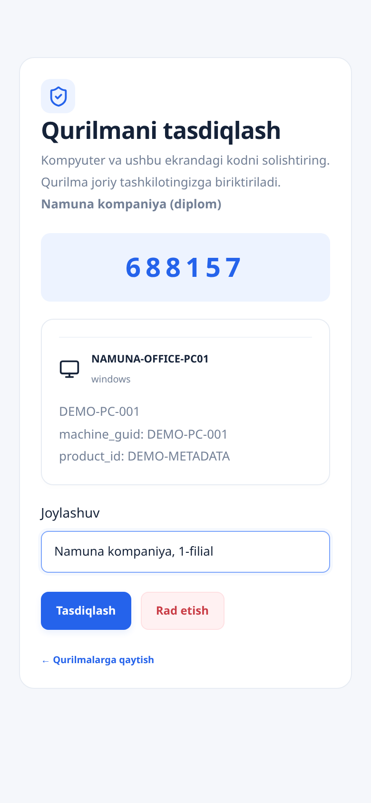
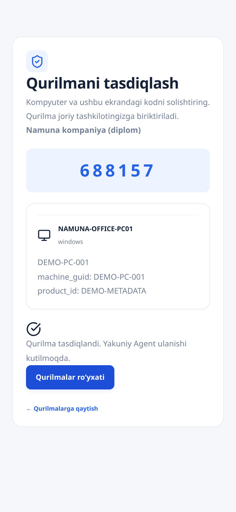
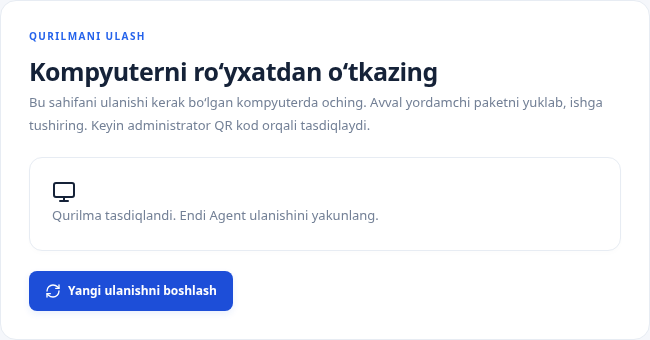
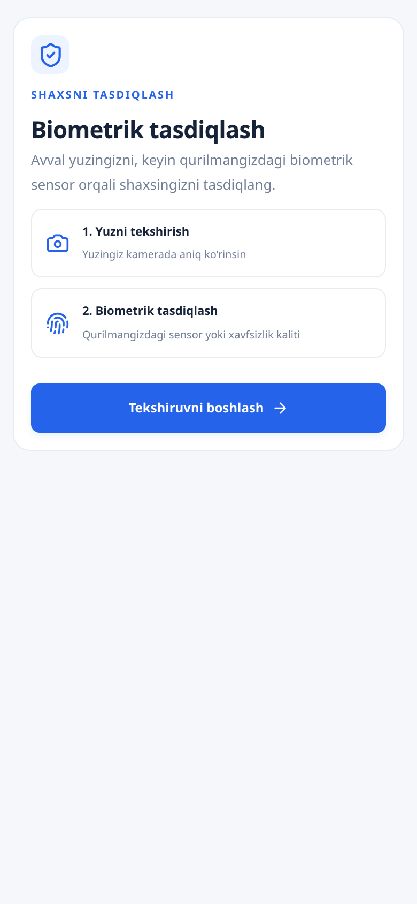
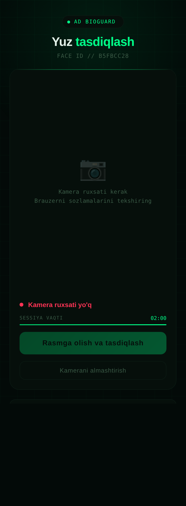

# Kompaniya PC’larini boshqarish va ro‘yxatdan o‘tkazish

### Kompaniyaning ko‘p kompyuterli muhitida ishlash modeli

Tizimning asosiy qo‘llanish sohasi bir kompaniyaga tegishli ko‘plab ishchi kompyuterlarni yagona markazdan hisobga olish va ulardagi autentifikatsiya jarayonlarini boshqarishdir. Bitta PC uchun dastur o‘rnatish bu vazifaning faqat boshlang‘ich qismidir. Kompaniya miqyosida qaysi qurilma qaysi tashkilotga tegishli ekani, uni kim ro‘yxatga olgani, qaysi foydalanuvchi sessiyasi tekshirilgani va oxirgi aloqa qachon bo‘lgani aniqlanishi kerak. Shaxsiy hisob oqimi mavjud bo‘lsa-da, mazkur ishning asosiy amaliy ssenariysi kompaniya kompyuterlari parkidir.

Kompaniyaning ishchi kompyuterlari turli bo‘lim, filial yoki lokal tarmoqlarda joylashishi mumkin. Bunda agent va markaziy server o‘rtasidagi aloqa uchun kompyuterlarning bitta lokal broadcast domenida bo‘lishi shart emas. Har bir agent sozlangan server manziliga murojaat qiladi. Lekin bu imkoniyat serverga yo‘l mavjudligini avtomatik ta’minlamaydi: DNS, HTTPS chiqish ruxsati, reverse proxy, sertifikat zanjiri va vaqt sinxronligi korporativ infratuzilmada alohida tayyorlanadi. Quyidagi sxema loyihaviy joylashuvni ko‘rsatadi; bir nechta haqiqiy filial tarmog‘idagi yuklama tajribasi bajarilgan deb talqin qilinmaydi.

Serverning tashkilot bo‘yicha ajratishi tarmoqni VLAN yoki firewall bilan segmentlashning o‘rnini bosmaydi. Bir tarmoqdagi begona qurilma boshqa tashkilot nomidan autentifikatsiyalana olmasligi uchun har bir server so‘rovida tashkilot va qurilma holati tekshiriladi. Aksincha, bir kompaniyaning boshqa filialidagi vakolatli agent faqat uning IP-manzili boshqacha bo‘lgani uchun yangi shaxs deb olinmaydi: identifikatsiyada ro‘yxatdagi kriptografik kalit va server yozuvi ustuvor bo‘ladi. IP-manzil audit konteksti bo‘lib xizmat qiladi.

Joriy modelda alohida Filial yoki TarmoqSegmenti obyekti mavjud emas. Qurilma joylashuvi Device.location maydoni orqali tavsiflanadi. Shuning uchun hujjatda to‘liq filiallar iyerarxiyasi yoki avtomatik tarmoq topologiyasi boshqaruvi amalga oshirilgan deb ko‘rsatilmaydi. Bunday imkoniyat kerak bo‘lsa, filial modeli, unga tayinlangan administratorlar va obyektlararo ruxsatlar alohida ishlab chiqiladi. Hozirgi versiyada tashkilot chegarasi va qurilma joylashuvi asosiy hisobga olish vositalaridir.

Xodim va PC o‘rtasidagi bog‘lanish ham aniq talqin qilinadi. Users tashkilotga hamda rolga, Device esa tashkilotga bog‘langan; AgentSession esa muayyan tekshiruvda foydalanuvchi va qurilmani birlashtiradi. Device modelida har bir PC uchun doimiy yagona xodim egasi maydoni yo‘q. Shu sababli tizim bir xodim bir PC bilan abadiy bog‘langan degan taxminga tayangan holda tavsiflanmaydi. Umumiy foydalaniladigan kompyuterlarda aynan joriy sessiyadagi foydalanuvchi muhimdir.

### Kompaniya PC’sini dastlabki ro‘yxatdan o‘tkazish

Quyidagi ekranlar ishlayotgan mahalliy serverdan olingan. Ko‘rsatish uchun vaqtinchalik Namuna kompaniya (diplom), NAMUNA-OFFICE-PC01 va DEMO-PC-001 yozuvlari ishlatilgan. Apparat identifikatorlari namuna sifatida kiritilgan; ushbu suratlar Go yordamchisi haqiqiy Windows qurilmasida ishga tushirilganining dalili emas. Administrator tasdig‘i esa haqiqiy server endpointlari orqali bajarilgan. Tasvirga olish tugagach, namunaviy yozuvlar va sessiyalar o‘chirilib, rasmdagi QR hamda tasdiqlash kodi amaldan chiqarilgan.

Birinchi bosqichda xodim ulanadigan PC brauzerida /device/scan sahifasini ochadi. Sahifa bu amal qaysi kompyuterda bajarilishi kerakligini tushuntiradi. Yangi ulanishni boshlash tugmasi serverda qisqa muddatli sessiya yaratadi. Kompaniyada bir nechta PC bir vaqtning o‘zida tayyorlanayotgan bo‘lsa, har bir kompyuter o‘z sessiyasini boshlaydi; bir PC uchun yaratilgan paket yoki havola boshqasiga ko‘chirib ishlatilmaydi.

Ikkinchi bosqichda operatsion tizim va arxitektura tanlanadi. Masalan, Windows hamda Intel / AMD (x64) tanlovlari shu platforma uchun yordamchi paketni olishga xizmat qiladi. Ushbu paket asosiy agent o‘rnatuvchisi emas. Yordamchining vazifasi joriy PC identifikatorlarini ro‘yxat sessiyasiga yuborishdir. Asosiy agent esa keyinchalik kalit va sertifikat bilan doimiy ishlaydigan komponent sifatida alohida o‘rnatiladi.

Uchinchi bosqichda yordamchi yuborgan identifikatorlar sessiyaga bir martalik scan token orqali qabul qilinadi. Server asosiy identifikator va device_id qiymatining mosligini tekshiradi. Shundan keyin PC ekranida QR-kod hamda solishtirish kodi ko‘rinadi. Qurilma hali faol agent sifatida ishlamaydi. Bu holat faqat administrator tekshirishi uchun ma’lumotlar tayyor bo‘lganini anglatadi.

To‘rtinchi bosqichda tegishli kompaniya administratori o‘z boshqaruv sessiyasi bilan QR havolani ochadi. Tasdiqlash sahifasida tashkilot nomi, hostname, platforma, identifikatorlar va solishtirish kodi ko‘rsatiladi. Administrator PC ekranidagi kod bilan o‘z ekranidagi kod bir xil ekanini tekshiradi. Tashkilot noto‘g‘ri tanlangan bo‘lsa, kompyuterni tasdiqlash davom ettirilmaydi. Bir nechta tarmoq yoki xonadagi o‘xshash nomli PC’lar bilan ishlaganda aynan shu solishtirish noto‘g‘ri qurilmani biriktirish xavfini kamaytiradi.

Beshinchi bosqichda administrator joylashuvni kiritadi va tasdiqlaydi yoki rad etadi. Namuna ssenariyda Namuna kompaniya, 1-filial tavsifi kiritilgan. Joylashuv amaldagi bazada tavsif maydoni hisoblanadi; u o‘z-o‘zicha alohida filial vakolatini yaratmaydi. Server vakolatli tasdiqdan so‘ng qurilmani shu tashkilotga biriktiradi. Bir xil sessiyani yana tasdiqlash yoki boshqa tashkilotdan qayta egallash ruxsat etilmaydi.

Oltinchi bosqichda PC brauzerida ham tasdiq natijasi ko‘rinadi. Qurilma browser_approved bo‘lsa-da, ro‘yxatdagi kriptografik kalit bilan aktivatsiya yakunlanmaguncha faol agentga tenglashtirilmaydi. Bu ajratish kompaniyada yangi kompyuterni inventar sifatida qabul qilish va undan server nomidan so‘rov yuborishga ruxsat berish orasidagi chegarani saqlaydi. Tasdiqlangan kompyuterning o‘zi boshqa PC uchun berilgan tokenni ishlatmasligi kerak.

### Windows agentini kompaniya PC’siga o‘rnatish

Ro‘yxatdan o‘tkazishdan keyin administrator yoki vakolatli texnik xodim mos Windows paketini oladi. Kompaniya siyosati yuklangan o‘rnatuvchining manbasi va yaxlitligini tekshirishni nazarda tutishi kerak. Tizim katalogi paketning haqiqiy mavjudligini va SHA-256 qiymatini ko‘rsatadi. Faqat fayl nomining to‘g‘ri ko‘rinishi uning joriy koddan yig‘ilganini isbotlamaydi; paket versiyasi hamda manba kodining holati solishtiriladi.

Joriy installer kodida aktivatsiya ma’lumotlari agent fayllarini nusxalashdan oldin olinadi. Xodim tashkilot tokenini belgilangan oynaga kiritadi va server tekshiruvini kutadi. Server tashkilot, qurilma va yangi kalitning mosligini tekshiradi. Xato bo‘lsa qayta urinish va bekor qilish imkoniyati saqlanadi. Ko‘plab PC’larni tayyorlashda umumiy bir martalik tokenni cheklanmagan sonli qurilmaga tarqatish nazarda tutilmaydi: tokenning sarflanishi va har bir qurilma uchun alohida aktivatsiya nazorat qilinadi.

Windows tizim fayllarini o‘rnatish uchun administrator huquqi talab qilinishi mumkin. Biroq foydalanuvchiga bog‘liq kalit va sertifikatni boshqa administrator profiliga yozib yuborish noto‘g‘ri natija beradi. Shu sababli aktivatsiya konteksti, o‘rnatish konteksti va agent ishlaydigan asl foydalanuvchi ajratiladi. O‘rnatish tugagach, agentning shu foydalanuvchi sessiyasida ishga tushishi, serverga imzolangan murojaati va boshqaruv panelida ko‘rinishi tekshiriladi [13].

Korporativ tarqatish ssenariysida sozlamalar izchilligi muhim. Barcha PC’lar mo‘ljallangan server manziliga murojaat qilishi, TLS tekshiruvini saqlashi va vaqtni to‘g‘ri yuritishi kerak. Tizimning hozirgi interaktiv token oynasi mavjudligi avtomatik ommaviy deploy, Active Directory yoki Group Policy orqali boshqariladigan o‘rnatish amalga oshirilganini anglatmaydi. Bunday tarqatish yo‘li alohida ishlab chiqish va kompaniya infratuzilmasida tekshirishni talab qiladi.

### Telefon interfeysi va foydalanuvchini biometrik ro‘yxatga olish

Kompaniya administratori qurilmani tasdiqlash uchun telefondan foydalanishi bilan xodimning shaxsini biometrik tekshirish ikki xil jarayondir. Birinchisida administrator PC’ni kompaniya tarkibiga qabul qiladi. Ikkinchisida esa foydalanuvchiga tegishli yuz namunasi yoki WebAuthn autentifikatori bilan ishlanadi. Foydalanuvchi interfeysida ikkala jarayon ham telefon orqali ochilishi mumkin, ammo sessiyalar va ularning ruxsatlari aralashtirilmaydi.

Mobil biometrik ro‘yxatga olish sahifasi tekshiruvni ikki bosqichda ko‘rsatadi: avval yuz tekshiriladi, keyin autentifikator bilan tasdiqlash bajariladi. Quyidagi tasvir 390 piksel kenglikdagi mobil brauzer ko‘rinishida haqiqiy server bergan vaqtinchalik sessiya orqali olingan. U boshlang‘ich interfeysni tasvirlaydi; kamera yoki barmoq izi sensori yordamida yakuniy muvaffaqiyatli tekshiruv bajarilganini ko‘rsatmaydi. WebAuthn autentifikatoridagi mahalliy tekshiruv aynan barmoq izi bilan bajarilishi majburiy emas.

Agent sessiyasiga tegishli /agent/mobile/face/ yo‘li boshqa mobil sahifani ochadi. Ushbu sahifa kameradan tasvir olishga ruxsat so‘raydi va joriy sessiya vaqtini ko‘rsatadi. Kamera mavjud bo‘lmagan yoki ruxsat berilmagan holatda tasdiqlashni davom ettirish mumkin emasligi aniq ko‘rinishi kerak. Bunday xato holatini foydalanuvchini tekshirish muvaffaqiyatiga aylantirish noto‘g‘ri bo‘ladi. Telefon brauzeri, kamera ruxsati va server origin mosligi amaliy joriy etishda alohida tekshiriladi.

### Ko‘p PC bilan kundalik ishlash, monitoring va qurilmani bekor qilish

Kundalik ishda administrator kompaniyaning foydalanuvchi va qurilmalarini markaziy panel orqali kuzatadi. Tekshiruv sessiyasi ma’lum foydalanuvchi va PC bilan bog‘lanadi. Xodimning holati yoki roli o‘zgarsa, kelgusi so‘rovlarda shu o‘zgarish hisobga olinishi kerak. Biroq bu rol o‘zgarishi Windowsdagi barcha fayl ACL yoki domen guruhlarini avtomatik qayta yozishini anglatmaydi. Boshqaruv panelidagi vakolatlar bilan operatsion tizimning mahalliy vakolatlari orasidagi integratsiya darajasi alohida ko‘rsatiladi.

AgentHealth va AgentEvent kompaniyadagi qurilmalar holatini kuzatishga xizmat qiladi. Server qabul qilgan vaqt bilan agent xabar qilgan vaqt ajratiladi, chunki ishchi kompyuter soati xato bo‘lishi mumkin. Joriy hujjatga ko‘ra, birinchi heartbeatdan keyin 120 soniya aloqa bo‘lmasa connection_lost hodisasi, aloqa tiklanganda connection_restored hodisasi qayd etiladi. Lekin aloqa uzilishi xodim ataylab agentni o‘chirganini isbotlamaydi: elektr, tarmoq yoki jarayon xatosi ham shunday natija berishi mumkin [12].

Panel yopiq vaqtda ham monitoring talab qilinsa, davriy sog‘liq tekshiruvi alohida ishga tushiriladi. Buning uchun loyihada Celery worker va Beat yoki check_agent_health boshqaruv buyrug‘ini reja bo‘yicha bajarish yo‘li ko‘rsatilgan. Faqat veb-serverni ishga tushirish ushbu davriy xizmatlarning ham ishlayotganini anglatmaydi. Kompaniyada joriy etish tekshiruvida shu xizmatlar, broker aloqasi va uzilish holatidagi kuzatuv ham qabul mezoniga kiritiladi.

Vakolatli administrator vaqtinchalik ishlamaslikka ruxsat bersa, uning kimligi, sababi va muddati qayd etiladi. Bunday ruxsat ogohlantirish siyosatiga ta’sir qilishi mumkin, lekin u agent oynasini har qanday sharoitda masofadan yopish degani emas. Server bergan yangi siyosat agentga yetib borishi uchun aloqa kerak bo‘ladi. Shu bois boshqa filialdagi tarmoq uzilishida administrator oynasidagi qaror bilan PC’dagi oxirgi ma’lum holat orasidagi farq hisobga olinadi.

PC xizmatdan chiqarilsa, boshqa tashkilotga berilsa yoki agent olib tashlansa, oddiy qurilma autentifikatsiyasi bekor qilinadi. Olib tashlash kodi muayyan qurilma va sertifikat avlodiga bog‘lanadi. Jarayon boshlanganidan so‘ng eski kalitdan oddiy autentifikatsiyada foydalanish davom etmasligi kerak. Audit yozuvlari esa hodisalar tarixini saqlash uchun qoladi. Bitta PC’ni bekor qilish boshqa faol kompaniya qurilmalarini avtomatik bloklash uchun asos bo‘lmasligi lozim.

Kompaniya miqyosidagi yakuniy qabul sinovlari kamida turli PC’larda parallel ro‘yxatga olish, noto‘g‘ri tashkilot administratori bilan tasdiqlash, bir foydalanuvchining turli PC’dagi sessiyalari, tarmoq uzilishi, sertifikat bekor qilinishi va agentni qayta o‘rnatish holatlarini qamrab oladi. Ko‘p foydalanuvchi yuklamasi bo‘yicha esa bir vaqtning o‘zidagi sessiyalar, javob vaqti, bazadagi yozuvlar to‘qnashuvi va navbatlar holati o‘lchanadi. Bu mezonlar tajriba rejasi sifatida beriladi; joriy ishda o‘lchanmagan throughput yoki maksimal PC soni uydirib kiritilmaydi.
